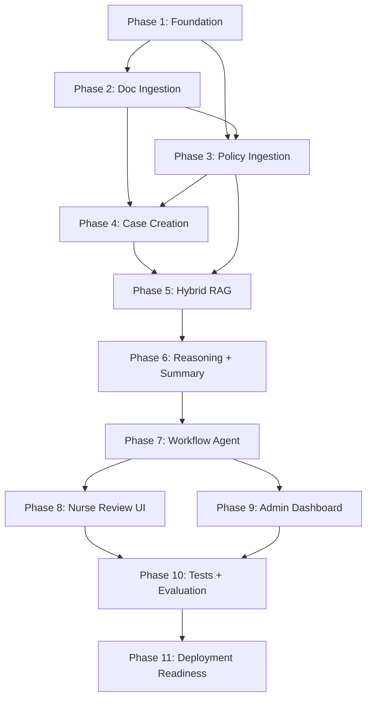

# Tasks: Prior Authorization Evidence Assistant

**Input**: Design documents from `/specs/001-pa-evidence-assistant/`

**Prerequisites**: plan.md ✅, spec.md ✅, research.md ✅, constitution.md ✅

**Tests**: Included in Phase 10 as a dedicated testing + evaluation phase per user instructions.

**Organization**: Tasks follow the user's 11-phase dependency-ordered structure, which maps naturally onto the 8 user stories: Foundation and infrastructure first (Phases 1–2), then feature delivery aligned to user stories (Phases 3–9), then testing + evaluation (Phase 10), and deployment readiness (Phase 11).

## Format: `[ID] [P?] [Story] Description`

- **[P]**: Can run in parallel (different files, no dependencies)
- **[Story]**: Which user story this task belongs to (e.g., US1, US2)
- Exact file paths included in descriptions
- **⚠️ FLAG**: Tasks that risk external network access, public API calls, or VRAM budget violations are explicitly flagged inline

## User Story → Phase Mapping

| User Story | Title | Priority | Primary Phase(s) |
|------------|-------|----------|-------------------|
| US8 | Authentication and Role-Based Access | P1 | Phase 1 (Foundation) |
| US1 | Admin Uploads and Names a Policy | P1 | Phase 3 (Policy Ingestion) |
| US2 | Intake User Creates a New PA Case | P1 | Phase 2 + 4 (Doc Ingestion + Case Creation) |
| US3 | Automated Pipeline Processes a Case | P1 | Phase 5 + 6 + 7 (RAG + Reasoning + Workflow) |
| US4 | Nurse Reviews and Decides on a Case | P1 | Phase 8 (Nurse Review UI) |
| US5 | Admin Oversees and Intervenes on Cases | P2 | Phase 9 (Admin Dashboard) |
| US6 | NLP Case Search | P2 | Phase 5 (Hybrid RAG) |
| US7 | Full Audit Trail | P2 | Phase 7 + 9 (woven into Workflow + Admin) |

---

## Phase 1: Foundation (Secrets, Schema, Auth, Docker Stack, Ollama)

**Purpose**: All blocking infrastructure — nothing else can start until this phase is complete. Covers US8 (Authentication and Role-Based Access) in full, plus the data layer and infrastructure checks.

**⚠️ CRITICAL**: No feature work (Phases 2–9) can begin until this phase is complete.

### 1a. Project Skeleton & Configuration

- [ ] T001 Create Python project configuration with all dependencies in `backend/pyproject.toml` — FastAPI, SQLAlchemy[asyncio], asyncpg, alembic, pydantic[settings], httpx, PyMuPDF, python-docx, opencv-python-headless, easyocr, APScheduler, passlib[bcrypt], python-jose[cryptography], qdrant-client, fastembed, boto3, ragas, langchain
  > **⚠️ FLAG (VRAM budget)**: EasyOCR pulls PyTorch with CUDA. Ensure `torch` version targets CUDA 12.x and stays within the 6GB VRAM budget. Pin `easyocr` to a version that supports `gpu=False` fallback for FR-047.
- [ ] T002 [P] Create React + TypeScript project via `npx -y create-vite@latest ./` in `frontend/` with React template, add Axios, React Router, and dev dependencies in `frontend/package.json`
- [ ] T003 [P] Implement secrets-management abstraction layer in `backend/app/core/secrets.py` — `SecretsProvider` protocol with `get(key) → str` method; `EnvSecretsProvider` implementation backed by environment variables / `.env` file; structured so a Vault/HSM backend can be swapped without changing call sites (FR-004, Constitution P9)
- [ ] T003a Wire credential-access audit logging into `backend/app/core/secrets.py` (same file as T003 — sequential):
  - `EnvSecretsProvider.get(key)` MUST log an access event — the key name only, never the resolved value — to a security/operational log distinct from the case `audit_log` (FR-040f). A simple `log_secret_access(key: str)` call inside `get()` is sufficient for v1; keeping the hook in the abstraction layer means a future Vault/HSM-backed provider inherits the same logging behavior automatically.
- [ ] T004 [P] Create application settings module in `backend/app/config.py` — Pydantic `BaseSettings` loading `DATABASE_URL`, `MINIO_ENDPOINT`, `MINIO_ACCESS_KEY`, `MINIO_SECRET_KEY`, `QDRANT_URL`, `TEI_URL`, `OLLAMA_URL`, `JWT_SECRET_KEY`, `JWT_ALGORITHM`, `ACCESS_TOKEN_EXPIRE_MINUTES`, `REFRESH_TOKEN_EXPIRE_DAYS`, `GPU_PRIORITY_POLICY`, `OCR_CPU_FALLBACK_TIMEOUT_SECONDS`, `TURN_BUDGET`, `SLA_DEADLINE_HOURS`, `LOCK_EXPIRY_HOURS`, `VRAM_BUDGET_MB`; all secrets accessed through `SecretsProvider` (T003)

### 1b. Database Schema & Migrations

- [ ] T005 Configure async SQLAlchemy engine and session factory in `backend/app/db/database.py` — async engine via `create_async_engine` with `asyncpg`, session maker, `get_db` dependency
- [ ] T006 Initialize Alembic for async migrations in `backend/alembic.ini` and `backend/app/db/migrations/env.py` — configure `sqlalchemy.url` from settings (T004)
- [ ] T007 Define all SQLAlchemy ORM models in `backend/app/db/models.py`:
  - `User`: id (UUID), username, hashed_password, role (enum: intake/nurse/admin), is_active, created_at, updated_at
  - `Policy`: id (UUID), name, description, version, is_active, created_at, updated_at, created_by (FK→User)
  - `PolicyRequirement`: id (UUID), policy_id (FK→Policy), requirement_text, ordinal, created_at
  - `Case`: id (UUID), policy_id (FK→Policy), member_id, provider_id, cpt_code, icd_code, service_type, status (enum: draft/processing/pending_nurse_review/accepted/rejected/error/re_verification_required), sla_start_at, decided_at, decided_by (FK→User), decision_comment, created_at, created_by (FK→User)
  - `CaseDocument`: id (UUID), case_id (FK→Case), original_filename, file_type, minio_object_key, sha256_hash, doc_type (enum: case_document), ocr_status (enum: not_needed/completed/failed), extracted_text_length, created_at
  - `PolicyDocument`: id (UUID), policy_id (FK→Policy), original_filename, file_type, minio_object_key, sha256_hash, created_at
  - `NurseDecision`: id (UUID), case_id (FK→Case), nurse_id (FK→User), decision (enum: accepted/rejected), comment, decided_at
  - `CaseLock`: id (UUID), case_id (FK→Case, unique), nurse_id (FK→User), locked_at, lock_expires_at
  - `AuditLog`: id (UUID), trace_id (UUID), case_id (FK→Case, nullable), actor_type (enum: user/agent/system), actor_id (str — user_id or agent name), action, model_name (nullable), model_version (nullable), input_summary (text, nullable), output_summary (text, nullable), confidence_score (float, nullable), retrieval_score (float, nullable), llm_confidence (float, nullable), timestamp, metadata (JSONB)
  - Enforce: `AuditLog` has no UPDATE/DELETE from app code (FR-040e) — document this as an application-layer invariant in the model docstring
- [ ] T008 Generate and apply initial Alembic migration in `backend/app/db/migrations/versions/` — `alembic revision --autogenerate -m "initial_schema"` then `alembic upgrade head`

### 1c. Authentication & Authorization (US8)

- [ ] T009 [US8] Implement JWT token creation and validation in `backend/app/core/security.py` — `create_access_token(subject, scopes, expires_delta)`, `create_refresh_token(subject)`, `decode_token(token) → TokenPayload`; short-lived access tokens (default 15 min), longer refresh tokens (default 7 days); JWT secret from SecretsProvider (T003)
- [ ] T010 [US8] Implement password hashing utilities in `backend/app/core/security.py` — `hash_password(plain) → str`, `verify_password(plain, hashed) → bool` using passlib bcrypt
- [ ] T011 [US8] Implement auth dependencies in `backend/app/api/deps.py`:
  - `get_current_user(token) → User` — decodes JWT, loads user from DB, raises 401 if invalid/expired
  - `require_role(*roles) → Depends` — factory returning a dependency that raises 403 if user's role not in allowed set
  - `get_current_active_user` — wraps `get_current_user` + checks `is_active`
  - Scope enumeration per role per FR-003a: Intake → `case:create, case:read, document:upload, policy:read`; Nurse → `case:read, case:lock, case:decide, history:read`; Admin → `case:*, policy:*, user:manage, audit:read, history:read`
- [ ] T012 [US8] Implement auth API endpoints in `backend/app/api/auth.py`:
  - `POST /api/auth/login` — OAuth2 password flow, returns access + refresh tokens
  - `POST /api/auth/refresh` — accepts refresh token, returns new access token
  - `GET /api/auth/me` — returns current user profile
  - Log failed auth attempts to audit_log (FR-040b)
  - Log denied cross-role access attempts (FR-040c)
- [ ] T013 [US8] Create FastAPI application entry point in `backend/app/main.py` — app factory with CORS middleware (localhost origins only for dev), include auth router, lifespan handler for DB connection pool and APScheduler startup
- [ ] T014 [P] [US8] Implement admin user-management endpoints in `backend/app/api/admin.py`:
  - `POST /api/admin/users` — create user (Admin only)
  - `GET /api/admin/users` — list users (Admin only)
  - `PATCH /api/admin/users/{user_id}` — deactivate user (Admin only)
  - All gated by `require_role("admin")`

### 1d. Docker Stack & Native Service Checks

- [ ] T015 [P] Create Docker Compose file in `docker/docker-compose.yml` with exactly four services:
  - `postgres`: PostgreSQL 16, port 5432, persistent volume, health check (`pg_isready`)
  - `qdrant`: Qdrant latest, port 6333/6334, persistent volume, health check (HTTP GET `/healthz`)
  - `tei`: ghcr.io/huggingface/text-embeddings-inference (CUDA image), serving `BAAI/bge-small-en-v1.5`, port 8080, health check (HTTP GET `/health`)
    > **⚠️ FLAG (VRAM budget)**: TEI CUDA image loads model into GPU memory. Ensure `--max-batch-tokens` and `--max-concurrent-requests` are configured to stay within the 6GB VRAM budget alongside Ollama (llama3.2:3b) and EasyOCR. Start conservative: `--max-batch-tokens 2048 --max-concurrent-requests 32`.
  - `minio`: MinIO latest, ports 9000/9001 (API/console), persistent volume, health check (HTTP GET `/minio/health/live`)
  - Shared network, `.env` file for credentials
  - **No Redis, no Celery, no reverse-proxy container**
- [ ] T016 [P] Create `.env.example` in `docker/.env.example` with all required environment variables (DB credentials, MinIO keys, JWT secret, service URLs) — no real secrets committed
- [ ] T017 [P] Implement startup health-check utility in `backend/app/core/healthcheck.py`:
  - `check_postgres()` — async connection test
  - `check_qdrant()` — HTTP GET to Qdrant health endpoint
  - `check_tei()` — HTTP GET to TEI health endpoint + test embedding call
  - `check_minio()` — boto3 `head_bucket` or `list_buckets` call
  - `check_ollama()` — HTTP GET to `http://localhost:11434/api/tags` to confirm Ollama is running and `llama3.2:3b` is available
    > **⚠️ FLAG (external network)**: Ollama's `ollama pull` command downloads model weights from the internet on first use. This is a one-time setup step, not a runtime code path. The health check only verifies the model is already present — it must NOT trigger a pull. Document this in the startup guide.
  - `run_all_checks()` — runs all checks, logs results, raises on any failure

**Checkpoint**: At this point, the backend boots, authenticates users with 3-role RBAC, connects to all four Docker services and native Ollama, and has a fully migrated Postgres schema. US8 (Authentication and Role-Based Access) is functionally complete at the API layer.

---

## Phase 2: Document Ingestion (Parsers, Preprocessing, OCR, MinIO Storage)

**Purpose**: Multi-format document parsing, image preprocessing, EasyOCR with GPU contention guard, and MinIO object storage. Foundational for both US1 (Policy Upload) and US2 (Case Creation).

### 2a. MinIO Storage Layer

- [x] T018 Implement MinIO S3 client service in `backend/app/services/minio.py`:
  - `ensure_bucket(bucket_name)` — create bucket if not exists (e.g. `pa-case-documents`, `pa-policy-documents`)
  - `upload_file(bucket, object_key, file_bytes, content_type) → str` — returns object key
  - `download_file(bucket, object_key) → bytes`
  - `delete_file(bucket, object_key)`
  - Object key convention: `{case_id}/{document_id}.{ext}` for case docs, `{policy_id}/{document_id}.{ext}` for policy docs
  - All calls via boto3 pointed at local MinIO endpoint from settings — never a public S3 endpoint
    > **⚠️ FLAG (external network)**: boto3 defaults to AWS endpoints. Explicitly set `endpoint_url` to the local MinIO URL from config. Verify no fallback to `s3.amazonaws.com` in any code path.

### 2b. Document Parsers

- [x] T019 Implement PDF parser in `backend/app/services/document.py`:
  - `parse_pdf(file_bytes) → list[PageResult]` — uses PyMuPDF; for each page: extract native text layer; if page has no extractable text (len(text.strip()) == 0), rasterize page to image at 300 DPI and flag for OCR
  - `PageResult`: dataclass with `page_number`, `text`, `needs_ocr`, `image_bytes` (nullable)
- [x] T020 Implement DOCX parser in `backend/app/services/document.py` (same file as T019 — sequential):
  - `parse_docx(file_bytes) → str` — uses python-docx to extract all paragraph text
- [x] T021 Implement TXT/MD parser in `backend/app/services/document.py` (same file as T019/T020 — sequential):
  - `parse_text(file_bytes, encoding="utf-8") → str` — direct decode with encoding detection fallback

### 2c. Image Preprocessing Pipeline

- [x] T022 Implement OpenCV image preprocessing pipeline in `backend/app/services/ocr.py`:
  - `preprocess_image(image_bytes) → np.ndarray` — sequential pipeline:
    1. Decode image bytes to numpy array
    2. Grayscale conversion (`cv2.cvtColor`)
    3. Deskew: detect skew angle via Hough transform or projection profile, rotate to correct
    4. Denoise (`cv2.fastNlMeansDenoising`)
    5. Adaptive binarization/thresholding (`cv2.adaptiveThreshold`)
    6. Contrast normalization (CLAHE — `cv2.createCLAHE`)
  - All CPU-only — no GPU contention
  - Returns preprocessed numpy array ready for EasyOCR

### 2d. GPU Contention Guard

- [x] T023 Implement GPU contention guard in `backend/app/core/gpu_guard.py`:
  - `GpuGuard` class with:
    - `asyncio.Lock` for exclusive GPU access
    - Priority levels: `LLM` (highest), `EMBEDDING`, `OCR` (lowest)
    - `acquire(priority, timeout_seconds) → bool` — acquires lock with priority-aware queuing; returns False if timeout exceeded
    - `release()`
    - Configurable via settings: `GPU_PRIORITY_POLICY` (str), `OCR_CPU_FALLBACK_TIMEOUT_SECONDS` (float, default 10)
  - Context manager: `async with gpu_guard.acquire_or_fallback(priority, timeout) as acquired:`
  - Log contention events (queue waits, CPU fallbacks) to operational log (FR-046d) — distinct from audit_log

### 2e. EasyOCR Integration

- [x] T024 Implement EasyOCR service in `backend/app/services/ocr.py`:
  - `OcrService` class:
    - Lazy-initialized EasyOCR reader (loaded once, reused)
    - `ocr_image(image_bytes) → str` — preprocesses via T022, acquires GPU guard (T023) with OCR priority and configured timeout; if guard acquisition times out, falls back to `gpu=False` (CPU mode) per FR-046a
    - `ocr_pdf_pages(pages: list[PageResult]) → list[str]` — for pages flagged `needs_ocr`, runs OCR; returns text for all pages
    - If GPU is entirely unavailable (FR-047), falls back to CPU and logs degraded mode
  - Image format support: JPEG, PNG, TIFF (decoded via OpenCV)
    > **⚠️ FLAG (VRAM budget)**: EasyOCR loads its recognition model into GPU memory. Combined with Ollama (llama3.2:3b) and TEI, total VRAM usage must stay ≤ 6GB. The GPU guard ensures these never run concurrently, but EasyOCR's model stays resident. Monitor VRAM after first OCR call. If over budget, configure EasyOCR with `gpu=False` as default and use GPU only when LLM and TEI are idle.

### 2f. Unified Document Processing

- [x] T025 Implement unified document processing service in `backend/app/services/document.py`:
  - `process_document(file_bytes, filename, file_type) → DocumentResult` — routes to appropriate parser (T019–T021) based on file_type; runs OCR (T024) on pages/images that need it; computes SHA-256 hash; returns `DocumentResult` with extracted_text, pages, ocr_status, sha256
  - `DocumentResult`: dataclass with `full_text`, `pages: list[PageText]`, `ocr_status` (not_needed/completed/failed), `sha256_hash`
  - Handles extraction failure: if zero text extracted from all pages/content, flags `ocr_status=failed` (FR-013a)

**Checkpoint**: At this point, the system can parse PDF/DOCX/TXT/MD/images, preprocess scans, run OCR with GPU contention protection, store files in MinIO, and handle extraction failures gracefully.

---

## Phase 3: Policy Ingestion (US1 — Admin Uploads and Names a Policy)

**Purpose**: Admin policy upload, policy name registry, Intake Agent requirement extraction, and policy_chunk embedding into Qdrant.

**Goal**: An Admin can upload a policy document, assign it a name, and the system extracts required evidence items and indexes the policy for hybrid retrieval.

**Independent Test**: Upload a synthetic policy PDF, assign it "Lumbar MRI Policy", verify it appears in the policy dropdown and that extracted requirements are listed.

### 3a. Ollama LLM Client

- [x] T026 [US1] Implement Ollama LLM client in `backend/app/services/ollama.py`:
  - `OllamaClient` class:
    - `generate(prompt, system_prompt, format_schema) → str` — calls Ollama `/api/generate` with `model=llama3.2:3b`, supports structured JSON output via `format` parameter
    - `chat(messages, format_schema) → str` — calls Ollama `/api/chat` for multi-turn
    - Acquires GPU guard (T023) with LLM priority before every call
    - Timeout handling: configurable per-call timeout; if Ollama is unreachable, raises `LLMUnavailableError`
    - All calls to `http://localhost:11434` — never an external LLM API
      > **⚠️ FLAG (external network)**: Hardcode the Ollama base URL from config. Ensure no code path can substitute an OpenAI/Anthropic/etc. API host.

### 3b. Embedding Service Client

- [x] T027 [US1] Implement TEI embedding client in `backend/app/services/embedding.py`:
  - `EmbeddingClient` class:
    - `embed(texts: list[str]) → list[list[float]]` — calls TEI `/embed` endpoint, returns 384-dim dense vectors
    - Batch support with configurable batch size
    - Acquires GPU guard (T023) with EMBEDDING priority before every call
    - All calls to local TEI container — never a cloud embedding API
      > **⚠️ FLAG (external network)**: TEI base URL must come from config pointing at the Docker container. Verify no HuggingFace Inference API fallback.
- [x] T028 [US1] Implement fastembed sparse encoder in `backend/app/services/embedding.py` (same file as T027 — sequential):
  - `SparseEncoder` class:
    - `encode_sparse(texts: list[str]) → list[SparseVector]` — uses fastembed BM25-style sparse encoding
    - Returns Qdrant-compatible sparse vectors
    - CPU-only — no GPU guard needed for fastembed

### 3c. Qdrant Collection Setup

- [x] T029 [US1] Implement Qdrant service in `backend/app/services/qdrant.py`:
  - `QdrantService` class:
    - `ensure_collection()` — creates `pa_documents` collection if not exists, with named vector configs:
      - `dense`: 384-dim, cosine distance (bge-small-en-v1.5)
      - `sparse`: sparse vector config for BM25-style encoding
    - `upsert_points(points: list[PointStruct])`
    - `delete_points(filter)`
    - `hybrid_search(query_dense, query_sparse, filter, top_k, doc_type) → list[SearchResult]` — prefetch dense + sparse results, fuse with RRF (Qdrant-native `fusion=rrf`), apply payload filter for `doc_type` scoping
    - `SearchResult`: dataclass with `point_id`, `score`, `payload`, `doc_type`

### 3d. Text Chunking

- [x] T030 [US1] Implement text chunking utility in `backend/app/services/chunking.py`:
  - `chunk_text(text, chunk_size=512, chunk_overlap=64) → list[Chunk]` — sentence-aware chunking (split on sentence boundaries, not mid-word); each chunk carries `start_char`, `end_char`, `page_number` (if available) for citation
  - `Chunk`: dataclass with `text`, `start_char`, `end_char`, `page_number`, `chunk_index`

### 3e. Intake Agent — Policy Ingestion Path

- [x] T031 [US1] Implement Intake Agent policy ingestion path in `backend/app/agents/intake.py`:
  - `ingest_policy(policy_id, document_bytes, filename, file_type) → PolicyIngestionResult`:
    1. Parse document (T025)
    2. Extract required evidence items via LLM structured-output prompt (T026) — prompt asks for a JSON array of `{requirement_text, requirement_category}`
    3. Save `PolicyRequirement` records to Postgres
    4. Chunk full text (T030)
    5. Embed chunks: dense via TEI (T027), sparse via fastembed (T028)
    6. Upsert into Qdrant as `policy_chunk` points with payload: `{doc_type: "policy_chunk", policy_id, chunk_index, page_number, text}`
    7. Return `PolicyIngestionResult` with extracted requirements count and chunk count

### 3f. Policy API & Admin UI

- [x] T032 [US1] Implement policy management API endpoints in `backend/app/api/policies.py`:
  - `POST /api/policies` — Admin only: upload policy document + policy name; triggers ingestion (T031); returns policy with extracted requirements
  - `GET /api/policies` — All roles: list active policies (name + id); for Intake, used to populate case-creation dropdown (FR-008)
  - `GET /api/policies/{policy_id}` — Admin only: full policy detail with requirements
  - `PATCH /api/policies/{policy_id}` — Admin only: deactivate policy (soft-delete, FR-009a) — removes from dropdown but does not invalidate existing cases
  - Audit log entries for policy upload and deactivation (FR-040a)
- [x] T033 [P] [US1] Create Policy Management page in `frontend/src/pages/PolicyManagement.tsx`:
  - Admin-only page (role-gated in router)
  - Upload form: file input (PDF/DOCX/TXT/MD) + Policy Name text field
  - On submit: POST to `/api/policies`, show confirmation with policy name + extracted requirements list
  - Policy registry table: list all policies with name, document count, requirement count, status (active/inactive), deactivate action
- [x] T034 [P] [US1] Create Sidebar navigation component in `frontend/src/components/Sidebar.tsx`:
  - Persistent sidebar, role-gated sections:
    - Case Management (Intake + Admin)
    - Nurse Review (Nurse + Admin)
    - Administrative Dashboard (Admin only)
  - Highlight active section
- [x] T035 [P] [US1] Create Login page in `frontend/src/pages/Login.tsx`:
  - Username/password form → POST `/api/auth/login`
  - Store access + refresh tokens (memory only — never localStorage per FR-043c)
  - Redirect to role-appropriate landing page
- [x] T036 [P] [US1] Implement API client with auth interceptors in `frontend/src/services/api.ts`:
  - Axios instance with base URL
  - Request interceptor: attach access token header
  - Response interceptor: on 401, attempt silent refresh via `/api/auth/refresh`; if refresh fails, redirect to login (FR-001b)
  - **Never store tokens or document content in localStorage/sessionStorage** (FR-043c)
- [ ] T037 [US1] Configure React Router with role-gated routing in `frontend/src/App.tsx`:
  - Protected route wrapper: checks auth state + required role(s)
  - Routes: `/login`, `/cases` (Intake+Admin), `/cases/new` (Intake), `/nurse-review` (Nurse+Admin), `/admin` (Admin), `/admin/policies` (Admin), `/admin/users` (Admin)
  - Redirect unauthenticated users to `/login`

**Checkpoint**: US1 is complete. Admin can upload policies, assign names, see extracted requirements. Policy names populate the dropdown. Auth and routing are working for all roles.

---

## Phase 4: Case Creation (US2 — Intake User Creates a New PA Case)

**Purpose**: Intake UI with policy dropdown and multi-file upload, Intake Agent metadata auto-extraction, case_document_chunk embedding, and case_profile generation in Qdrant.

**Goal**: An Intake user uploads case documents, selects a policy, reviews auto-extracted metadata, submits the case, and the case appears in the queue with status "Processing."

**Independent Test**: Upload a synthetic case document against an existing policy, verify form is pre-filled, correct one field, submit, and confirm case appears with status "Processing."

### 4a. Case API

- [x] T038 [US2] Implement case management API endpoints in `backend/app/api/cases.py`:
  - `POST /api/cases` — Intake only: create case draft with policy_id
  - `POST /api/cases/{case_id}/documents` — Intake only: upload one or more documents (multi-file); triggers document processing (T025) + MinIO upload (T018) + sha256/metadata storage in Postgres
  - `POST /api/cases/{case_id}/extract-metadata` — Intake only: triggers LLM metadata extraction, returns auto-extracted fields for confirmation
  - `POST /api/cases/{case_id}/submit` — Intake only: validates case has documents, sets status to `processing`, records `sla_start_at = now()`, creates audit entry for case creation (FR-040a); if all documents have `ocr_status=failed`, return warning requiring explicit confirmation (FR-013a); on confirmed resubmission, write an audit entry with action `all_documents_failed_confirmed` (FR-040a) before the `case_created` audit entry
  - `GET /api/cases` — Intake + Admin: list all cases with status, SLA clock, metadata
  - `GET /api/cases/{case_id}` — role-scoped: Intake sees metadata only; Nurse sees full detail only if locked by them (FR-023); Admin sees everything

### 4b. Intake Agent — Case Document Path

- [x] T039 [US2] Implement Intake Agent case document processing in `backend/app/agents/intake.py`:
  - `process_case_documents(case_id) → CaseDocumentResult`:
    1. For each case document: parse via document processor (T025), upload raw file to MinIO (T018), store metadata + sha256 in Postgres `CaseDocument` table
    2. Chunk extracted text (T030) per document
    3. Embed chunks: dense (T027) + sparse (T028)
    4. Upsert into Qdrant as `case_document_chunk` points with payload: `{doc_type: "case_document_chunk", case_id, document_id, chunk_index, page_number, text}`
    5. Return per-document results with chunk counts and OCR status

- [x] T040 [US2] Implement Intake Agent metadata auto-extraction in `backend/app/agents/intake.py`:
  - `extract_case_metadata(case_id, combined_text) → CaseMetadata`:
    - LLM structured-output prompt (T026) to extract: `{member_id, provider_id, cpt_code, icd_code, service_type}` from the concatenated document text
    - Returns `CaseMetadata` dataclass with extracted fields (all nullable — LLM may not find every field)
    - Uses the same local LLM as all other inference (FR-043a)
    - The extraction prompt MUST include only the document text being extracted from for this call — never other case documents, other cases, or fields not relevant to metadata extraction (FR-043b)

- [x] T041 [US2] Implement case_profile point generation in `backend/app/agents/intake.py`:
  - `generate_case_profile(case_id) → None`:
    1. Load case metadata + all document titles from Postgres
    2. Generate a short summary of the case via LLM (T026) — one paragraph describing the case type, key identifiers, and document set
    3. Embed the summary: dense (T027) + sparse (T028)
    4. Upsert into Qdrant as a single `case_profile` point with payload: `{doc_type: "case_profile", case_id, member_id, provider_id, cpt_code, icd_code, service_type, status, policy_name, summary, document_titles: [...]}`
    - This point powers NLP case search (Phase 5) without a separate search index

### 4c. Case Creation UI

- [x] T042 [P] [US2] Create New Case page in `frontend/src/pages/NewCase.tsx`:
  - Policy dropdown populated from `GET /api/policies` (names only, FR-008)
  - Multi-file upload zone (drag-and-drop, accepts PDF/DOCX/TXT/MD/JPEG/PNG/TIFF per FR-013)
  - Upload progress indicators per file
  - After upload: "Extract Metadata" button → calls `POST /api/cases/{case_id}/extract-metadata`
  - Auto-filled form fields: Member ID, Provider ID, CPT/HCPCS Code, ICD-10 Code, Service Type — all editable (FR-012)
  - Submit button → `POST /api/cases/{case_id}/submit`
  - Warning dialog if all documents failed extraction (FR-013a) — requires explicit confirmation
- [x] T043 [P] [US2] Create Case Management page in `frontend/src/pages/CaseManagement.tsx`:
  - Case list table: Case ID, policy name, service type, status, SLA clock, submitted date
  - Status badge per case (color-coded: processing, pending review, accepted, rejected, error, re-verification)
  - "New Case" button → navigates to `/cases/new`
  - Visible to Intake + Admin roles
- [x] T044 [P] [US2] Create CaseCard component in `frontend/src/components/CaseCard.tsx`:
  - Reusable card showing case heading: Case ID, service type, status badge, SLA timer (computed from `sla_start_at` to now), submitted date
  - Used in Case Management list and Nurse Review queue

**Checkpoint**: US2 is complete. Intake users can create cases, upload documents, review auto-extracted metadata, submit cases. Cases appear in the queue with status "Processing."

---

## Phase 5: Hybrid RAG (US3 partial + US6 — Retrieval Agent, NLP Case Search)

**Purpose**: Dense + sparse indexing confirmed in Qdrant, RRF fusion query path, Retrieval Agent implementation, NLP case-search Query Understanding, search endpoint and UI search bars.

**Goal**: Retrieval Agent can find relevant evidence chunks for policy requirements via hybrid search. NLP search translates free-text queries into structured searches over case_profile points.

**Independent Test**: Submit a hybrid query for a known policy requirement against indexed case documents; verify top-5 results include the correct evidence passage. Submit NLP search "MRI cases" and verify case-level results.

### 5a. Retrieval Agent

- [x] T045 [US3] Implement Retrieval Agent in `backend/app/agents/retrieval.py`:
  - `retrieve_evidence(case_id, policy_requirement, query_augmentation=None) → list[RetrievalResult]`:
    1. Build query text from `policy_requirement.requirement_text` + optional `query_augmentation` (from Workflow Agent re-invocation)
    2. Embed query: dense (T027) + sparse (T028)
    3. Execute hybrid search (T029) scoped to `doc_type=case_document_chunk` AND `case_id=this_case`
    4. Return top-k results (default k=5) with: `chunk_text`, `score`, `document_id`, `page_number`, `chunk_index`
  - `RetrievalResult`: dataclass with `chunk_text`, `score`, `document_id`, `document_name`, `page_number`, `chunk_index`

### 5b. NLP Case Search — Query Understanding

- [x] T046 [US6] Implement NLP search Query Understanding in `backend/app/agents/retrieval.py`:
  - `parse_search_query(user_query: str) → StructuredSearchRequest`:
    - Small LLM call (T026) with structured-output prompt that parses free-text into:
      ```json
      {
        "semantic_query": "free-text semantic portion",
        "filters": {
          "cpt_code": null | "string",
          "icd_code": null | "string",
          "member_id": null | "string",
          "provider_id": null | "string",
          "date_range": null | {"start": "iso", "end": "iso"},
          "status": null | "string",
          "policy_name": null | "string"
        }
      }
      ```
    - The LLM's role is strictly translating intent into a structured query — it never reads through case documents (FR-036)
    - Uses same local LLM, same GPU guard (FR-036a, FR-046c)
      > **⚠️ FLAG (external network)**: This LLM call MUST use the local Ollama instance. Verify no fallback to a cloud NLU/intent-parsing API.

- [x] T047 [US6] Implement NLP search execution in `backend/app/agents/retrieval.py`:
  - `execute_case_search(structured_request: StructuredSearchRequest, role: str) → list[CaseSearchResult]`:
    1. Build Qdrant payload filter from extracted `filters` (exact match on `cpt_code`, `icd_code`, `member_id`, `provider_id`, `status`, `policy_name`; date range filter on case creation date)
    2. For filters that reference Postgres-only data (e.g. `provider_id` exact match), do a Postgres lookup first to get case_ids, then add to Qdrant filter
    3. Embed `semantic_query`: dense (T027) + sparse (T028)
    4. Execute hybrid search scoped to `doc_type=case_profile` points, with the Qdrant payload filter
    5. Apply role-based visibility post-retrieval (FR-039a): Nurse results show metadata only for non-locked cases
    6. Return case-level results (Case ID, service type, status, date, policy name) — never raw document chunks (FR-038)

### 5c. Search API & UI

- [x] T048 [US6] Implement search API endpoint in `backend/app/api/cases.py`:
  - `POST /api/cases/search` — all roles: accepts `{query: string}`, returns `list[CaseSearchResult]`
  - Internally calls `parse_search_query` (T046) → `execute_case_search` (T047)
  - Role passed from auth context for visibility filtering

- [x] T049 [P] [US6] Create SearchBar component in `frontend/src/components/SearchBar.tsx`:
  - Free-text input with search icon
  - Debounced search on type (300ms) or on Enter
  - Calls `POST /api/cases/search`
  - Displays results as case-level entries in a dropdown list
  - Used on Case Management, Nurse Review, and Admin Dashboard pages

**Checkpoint**: Retrieval Agent performs hybrid search for evidence matching. NLP search bar works across all role-gated sections. US6 (NLP Case Search) is functionally complete.

---

## Phase 6: Reasoning + Summary Agents (US3 partial)

**Purpose**: Reasoning Agent classifies evidence as Present/Absent/Unclear with citations and confidence. Summary Agent generates nurse-facing evidence summary and gap checklist.

**Goal**: Given retrieved evidence chunks for a case's policy requirements, produce a structured evidence summary with classifications, citations, and confidence scores.

**Independent Test**: Run Reasoning Agent on a known requirement with known retrieved chunks; verify classification, citation, and confidence score. Run Summary Agent on a full set of verdicts; verify evidence summary and gap checklist.

### 6a. Reasoning Agent

- [x] T050 [US3] Implement Reasoning Agent in `backend/app/agents/reasoning.py`:
  - `classify_requirement(policy_requirement, retrieved_chunks: list[RetrievalResult]) → RequirementVerdict`:
    - LLM structured-output prompt (T026) that:
      1. Presents the policy requirement text
      2. Presents each retrieved chunk with its source document + page
      3. Asks the LLM to classify: `Present` / `Absent` / `Unclear` (FR-021 semantics: Absent = no relevant evidence found; Unclear = evidence found but ambiguous/contradictory/insufficient)
      4. Asks for a citation (document_id, page_number, relevant_excerpt) for Present/Unclear verdicts
      5. Asks for a self-reported confidence score (0.0–1.0)
    - Compute composite confidence: `0.4 × max(retrieval_scores) + 0.6 × llm_confidence` (FR-021, configurable weights)
    - Log both component scores individually in audit trail
    - The classification prompt MUST include only the policy requirement text and the retrieved chunks for that requirement — never the full case record, other requirements' evidence, or other cases' data (FR-043b)
  - `RequirementVerdict`: dataclass with `requirement_id`, `requirement_text`, `classification` (enum), `citation` (nullable), `composite_confidence`, `retrieval_score`, `llm_confidence`, `reasoning_text`

- [x] T051 [US3] Implement batch requirement classification in `backend/app/agents/reasoning.py`:
  - `classify_all_requirements(case_id, policy_id) → list[RequirementVerdict]`:
    1. Load all `PolicyRequirement` records for the policy
    2. For each requirement, call Retrieval Agent (T045) to get evidence chunks
    3. For each requirement + chunks, call `classify_requirement` (T050)
    4. Return full list of verdicts
    - If Retrieval finds no evidence for any requirement, all classify as "Absent" (Edge Case)

### 6b. Summary Agent

- [x] T052 [US3] Implement Summary Agent in `backend/app/agents/summary.py`:
  - `generate_summary(case_id, verdicts: list[RequirementVerdict]) → CaseSummary`:
    - LLM structured-output prompt (T026) that:
      1. Receives the full set of requirement verdicts with their classifications and citations
      2. Generates a structured nurse-facing evidence summary: per-requirement status with citation reference
      3. Generates a gap checklist: separate sections for "Absent" and "Unclear" requirements (FR-022) with different visual indicators
      4. "Unclear" items include the ambiguous citation so the Nurse can evaluate directly
      5. Grounded strictly in the verdicts and citations already produced — no new claims (Constitution P4)
    - Summary text MUST be composed from requirement verdicts and their short cited excerpts only — never by reproducing a full source document or page verbatim (FR-043b, Constitution P4)
    - If the case hit the turn budget (partial results), flags "Pipeline incomplete — partial analysis" in the summary
    - If all documents had extraction failure, flags "No extractable content" (FR-013a)
  - `CaseSummary`: dataclass with `summary_text`, `gap_checklist` (list of `{requirement, classification, citation, confidence}`), `flags` (list of warning strings)

**Checkpoint**: Reasoning and Summary agents are complete. Given a processed case with indexed documents and a linked policy, the system can produce a full evidence summary with classifications, citations, confidence scores, and a gap checklist.

---

## Phase 7: Workflow Agent Orchestration (US3 completion + US7)

**Purpose**: The LLM-driven planner that coordinates all four worker agents, with guardrails, turn budget, case status state machine, and comprehensive audit logging.

**Goal**: A submitted case is automatically processed end-to-end: documents embedded, evidence retrieved, requirements classified, summary generated, case routed to Nurse Review queue. Every step is audit-logged.

**Independent Test**: Submit a synthetic case, verify pipeline completes, evidence summary exists, case status is "Pending Nurse Review", and audit trail contains all planner decisions and agent steps.

### 7a. Audit Log Service

- [x] T053 [US7] Implement audit log service in `backend/app/services/audit.py`:
  - `AuditService` class:
    - `log(trace_id, case_id, actor_type, actor_id, action, model_name=None, model_version=None, input_summary=None, output_summary=None, confidence_score=None, retrieval_score=None, llm_confidence=None, metadata=None)` — insert-only, never update/delete (FR-040e)
    - `get_case_audit_trail(case_id) → list[AuditEntry]` — chronological history for a case
    - `log_auth_event(username, outcome, ip_address)` — for failed auth attempts (FR-040b)
    - `log_access_denial(user_id, resource, method)` — for authorization failures (FR-040c)
  - Audit entry actions include (FR-040a): `case_created`, `policy_uploaded`, `policy_deactivated`, `user_created`, `user_deactivated`, `case_locked`, `case_lock_auto_released`, `case_re_verification`, `pipeline_cancelled_restarted`, `all_documents_failed_confirmed`, `turn_budget_exhausted`, `pipeline_error`, `planner_decision`, `agent_invocation`, `retrieval_query`, `reasoning_verdict`, `summary_generated`, `nurse_decision`, `admin_edit`

### 7b. Workflow Agent — Planner

- [x] T054 [US3] Implement Workflow Agent planner in `backend/app/agents/workflow.py`:
  - `WorkflowAgent` class:
    - Action whitelist (enum): `call_intake_agent`, `call_retrieval_agent`, `call_reasoning_agent`, `call_summary_agent`, `request_additional_evidence`, `finalize_to_nurse_review`
    - `plan_next_action(case_id, case_state, action_history) → PlannedAction`:
      - Constructs planner prompt with: current case state (status, documents, existing verdicts), history of actions already taken this case, the whitelist of allowed actions
      - Calls LLM (T026) with structured JSON output: `{action: str, reasoning: str}`
      - **Validation layer**: rejects anything outside the whitelist; re-prompts on malformed response (up to 3 retries, then defaults to `finalize_to_nurse_review` — subject to the FR-018 check: if Summary hasn't run yet, force `call_summary_agent` first)
      - Returns `PlannedAction` with `action`, `reasoning`
    - **Hard guardrails (non-LLM, deterministic logic)**:
      - Per-case turn budget (default 10, configurable via settings): forces `finalize_to_nurse_review` once reached (FR-016)
      - `finalize_to_nurse_review` is only accepted if Summary Agent has produced output at least once this case (FR-018)
      - The planner can NEVER emit anything resembling accept/reject — that action doesn't exist in the whitelist (FR-017, Constitution P1)
    - `PlannedAction`: dataclass with `action` (enum), `reasoning` (str), `turn_number` (int)

- [x] T055 [US3] Implement Workflow Agent execution loop in `backend/app/agents/workflow.py`:
  - `run_pipeline(case_id) → PipelineResult`:
    1. Generate trace_id for this pipeline run
    2. Load case state from Postgres
    3. Loop:
       a. Call `plan_next_action` (T054)
       b. Write audit entry BEFORE execution: `{trace_id, case_id, actor="workflow_agent", action="planner_decision", input_summary=case_state, output_summary=planned_action.reasoning}` (FR-015)
       c. Execute the planned action:
          - `call_intake_agent` → T039 (process case documents) + T041 (generate case_profile)
          - `call_retrieval_agent` → T045 (retrieve evidence for each requirement)
          - `call_reasoning_agent` → T051 (classify all requirements)
          - `call_summary_agent` → T052 (generate summary)
          - `request_additional_evidence` → update case state, set flag for Nurse
          - `finalize_to_nurse_review` → set status to `pending_nurse_review`
       d. Write audit entry for execution result
       e. Check guardrails: if turn budget exceeded, force `finalize_to_nurse_review` (with Summary first if not yet done)
       f. If `finalize_to_nurse_review` was executed, break loop
    4. On error (LLM unavailable, unhandled exception): set case status to `error`, write audit entry for pipeline_error (FR-040a), log error details — case appears in Nurse Review queue flagged "Error / Manual Review Required" (Edge Case)
    5. Return `PipelineResult` with final status, turn count, agent call history

### 7c. Case Status State Machine

- [x] T056 [US3] Implement case status transitions in `backend/app/agents/workflow.py`:
  - Valid transitions:
    - `draft` → `processing` (on case submit)
    - `processing` → `pending_nurse_review` (pipeline complete)
    - `processing` → `error` (pipeline failure)
    - `pending_nurse_review` → `accepted` (Nurse decision)
    - `pending_nurse_review` → `rejected` (Nurse decision)
    - `accepted` → `re_verification_required` (Admin edit)
    - `rejected` → `re_verification_required` (Admin edit)
    - `re_verification_required` → `processing` (re-verification pipeline starts)
    - `error` → `pending_nurse_review` (manual review — Nurse can lock and review without AI summary)
  - `transition_status(case_id, from_status, to_status) → bool` — validates transition is allowed, updates Postgres, writes audit entry
  - Invalid transitions raise `InvalidStatusTransitionError`

### 7d. Pipeline Trigger

- [x] T057 [US3] Wire pipeline trigger into case submission in `backend/app/api/cases.py`:
  - After `POST /api/cases/{case_id}/submit` sets status to `processing`, launch `run_pipeline(case_id)` (T055) as a background task (`asyncio.create_task` or FastAPI `BackgroundTasks`)
  - Pipeline runs asynchronously — the submit endpoint returns immediately with status "Processing"
  - If Admin cancels/restarts an in-flight pipeline (FR-012a), the running task is cancelled and a new pipeline is started

**Checkpoint**: US3 (Automated Pipeline) and US7 (Full Audit Trail) are functionally complete. Cases are processed end-to-end with full audit logging. The pipeline is bounded, auditable, and never makes accept/reject decisions.

---

## Phase 8: Nurse Review UI (US4 — Nurse Reviews and Decides)

**Purpose**: Pre-lock metadata-only queue view, lock/unlock actions, APScheduler 24-hour auto-release job, evidence summary + document viewer, Accept/Reject with mandatory comment, per-nurse History tab.

**Goal**: A Nurse sees the review queue with metadata only, locks a case, reviews evidence and documents, and records a decision.

**Independent Test**: As a Nurse, view the queue, verify only metadata is visible, lock a case, verify evidence summary and documents become accessible, submit an Accept decision with comment, verify it appears in History.

### 8a. Case Locking API

- [x] T058 [US4] Implement case locking endpoints in `backend/app/api/nurse_review.py`:
  - `POST /api/nurse-review/{case_id}/lock` — Nurse only: creates CaseLock record (case_id, nurse_id, locked_at, lock_expires_at = now + 24h); fails with 409 if already locked by another nurse (FR-025); writes audit entry for `case_locked`
  - `DELETE /api/nurse-review/{case_id}/lock` — Nurse only (lock owner) or Admin: releases lock; writes audit entry
  - `GET /api/nurse-review/queue` — Nurse + Admin: returns cases with status `pending_nurse_review` or `error`, showing metadata only (Case ID, service type, submitted date, SLA clock, lock status) — no summary/evidence/documents (FR-023)

### 8b. APScheduler Lock Auto-Release

- [x] T059 [US4] Implement APScheduler lock auto-release job in `backend/app/services/scheduler.py`:
  - `release_expired_locks()`:
    - Query `CaseLock` for records where `lock_expires_at < now()`
    - For each expired lock: delete the CaseLock record, write audit entry for `case_lock_auto_released` (FR-040a)
    - Run on an interval (every 5 minutes) via APScheduler `IntervalTrigger`
  - Register the job in the FastAPI lifespan handler (T013)
  - SC-008: Lock must auto-release within 60 seconds of the 24-hour threshold — 5-minute interval satisfies this

### 8c. Nurse Decision API

- [x] T060 [US4] Implement nurse decision endpoint in `backend/app/api/nurse_review.py`:
  - `POST /api/nurse-review/{case_id}/decide` — Nurse only (lock owner): body `{decision: "accepted"|"rejected", comment: str (required)}`
    - Validates: case is locked by this nurse, comment is non-empty (FR-028)
    - Creates `NurseDecision` record
    - Transitions case status: `pending_nurse_review` → `accepted` or `rejected` (T056)
    - Sets `decided_at`, `decided_by` on Case
    - Releases the lock
    - Writes audit entry for `nurse_decision` with comment (FR-040d)
  - `GET /api/nurse-review/history` — Nurse: returns own decided cases; Admin can pass `?nurse_id=` to view any nurse's history (FR-029a)

### 8d. Nurse Review UI

- [x] T061 [P] [US4] Create Nurse Review queue page in `frontend/src/pages/NurseReview.tsx`:
  - Queue table: Case ID, service type, submitted date, SLA clock (live timer), lock status indicator, "Re-verification Required" flag, "Error / Manual Review" flag
  - No summary/evidence/document content visible before locking (FR-023)
  - "Lock" button per unlocked case → `POST /api/nurse-review/{case_id}/lock`
  - Locked-by-another indicator for cases locked by other nurses
  - SearchBar component (T049) for NLP case search
- [x] T062 [P] [US4] Create Case Detail page for locked cases in `frontend/src/pages/CaseDetail.tsx`:
  - Accessible only after locking (redirects back to queue if not locked by current user)
  - Tab layout: "Evidence Summary" | "Documents" (nurse's choice which to view first, FR-027)
  - Evidence Summary tab: renders `CaseSummary` (T052) with:
    - Per-requirement row: requirement text, classification badge (Present=green, Absent=red, Unclear=amber), confidence score, citation link
    - Gap checklist: separate "Absent" section and "Unclear" section with distinct visual indicators (FR-022)
    - "Unclear" items show the ambiguous citation inline
    - Pipeline warning flags (turn budget hit, extraction failures)
  - Documents tab: list of case documents with viewer (PDF inline viewer or text display)
  - Decision panel: Accept / Reject radio + mandatory comment textarea + Submit button
- [x] T063 [P] [US4] Create EvidenceSummary component in `frontend/src/components/EvidenceSummary.tsx`:
  - Renders the structured evidence summary with classification badges, confidence bars, and citations
  - Separate sections for Present, Absent, Unclear requirements
- [x] T064 [P] [US4] Create GapChecklist component in `frontend/src/components/GapChecklist.tsx`:
  - "Absent" items: red indicator, requirement text, "No evidence found" label
  - "Unclear" items: amber indicator, requirement text, ambiguous citation displayed inline for Nurse evaluation
- [x] T065 [P] [US4] Create DocumentViewer component in `frontend/src/components/DocumentViewer.tsx`:
  - Renders case documents: PDF inline viewer (using browser PDF rendering or react-pdf), text/MD rendered as formatted text
  - Document list sidebar with filename, type badge, OCR status indicator, "Extraction Failed" flag
- [x] T066 [US4] Create Nurse History tab in `frontend/src/pages/NurseReview.tsx`:
  - Tab within Nurse Review section: "Queue" | "History"
  - History table: Case ID, service type, decision (Accepted/Rejected badge), comment preview, decided date
  - Click to view read-only case detail (no re-decision)

### 8e. Polling for Status Updates

- [x] T067 [US4] Implement polling for case status and lock updates in frontend:
  - `usePolling` hook in `frontend/src/hooks/usePolling.ts`:
    - Configurable interval (default 15 seconds)
    - Polls `GET /api/cases` or `GET /api/nurse-review/queue` for status changes
    - Updates case list / queue view reactively
    - No WebSocket infrastructure in v1 (per spec)

**Checkpoint**: US4 (Nurse Reviews and Decides) is complete. Nurses can browse the queue (metadata only), lock cases, review evidence summaries and documents, record decisions, and view their history. Lock auto-release runs on schedule.

---

## Phase 9: Admin Dashboard (US5 — Admin Oversight + Intervention)

**Purpose**: All-cases view with lock/verification status, case edit/intervention with automatic re-verification routing, nurse account management, audit log viewer.

**Goal**: Admin has full operational oversight: sees all cases, can intervene on any case (triggering re-verification), manages nurse accounts, and views the complete audit trail.

**Independent Test**: As Admin, view all cases, modify a field on an Accepted case, verify it returns to the Nurse Review queue with "Re-verification Required" flag and the original decision is invalidated.

### 9a. Admin Case Intervention API

- [x] T068 [US5] Implement admin case intervention endpoint in `backend/app/api/admin.py`:
  - `PATCH /api/admin/cases/{case_id}` — Admin only: update case fields (member_id, provider_id, cpt_code, icd_code, service_type, add/remove documents)
    - If case status is `accepted` or `rejected`:
      1. Invalidate the `NurseDecision` (FR-032)
      2. Release any lock (if locked, Edge Case: Admin modifies locked case)
      3. Transition status to `re_verification_required` (T056)
      4. Write audit entry for `admin_edit` and `case_re_verification`
      5. If documents were changed, the case will need re-processing — set status to `processing` and restart pipeline (T055)
    - SC-009: Invalidation must complete within 5 seconds — this is a single DB transaction
  - `GET /api/admin/cases` — Admin only: all cases across all queues, with status, lock holder, verification status, SLA clock
  - `GET /api/admin/nurses/workload` — Admin only: per-nurse view with currently locked cases and decided-case counts (FR-033)
  - `GET /api/admin/nurses/{nurse_id}/history` — Admin only: view any nurse's decision history (FR-029a)

### 9b. Audit Trail API

- [x] T069 [US7] Implement audit trail viewer endpoint in `backend/app/api/admin.py`:
  - `GET /api/admin/audit/{case_id}` — Admin only: returns complete chronological audit trail for a case (FR-041, FR-041a)
  - `GET /api/admin/audit` — Admin only: global audit log with filtering (date range, actor, action type)
  - Both endpoints return entries with all required fields: timestamp, actor identity, action type, model/version (if AI), confidence score (if AI), comment (if human) per FR-040d

### 9c. Admin Dashboard UI

- [x] T070 [US5] Create Admin Dashboard page — all-cases view — in `frontend/src/pages/AdminDashboard.tsx`:
  - All-cases table: Case ID, service type, status, lock holder (if any), verification status, SLA clock, policy name
  - Inline case edit action: opens modal with editable fields (member_id, provider_id, cpt_code, icd_code, service_type) → PATCH endpoint (T068)
  - Warning confirmation for editing decided cases: "This will invalidate the existing decision and re-queue the case"
  - Nurse workload panel: table of nurses with locked-case count and decided-case count; click to view nurse's history
  - SearchBar component (T049) for NLP case search
- [x] T071 [US5] Add Audit Log viewer section to `frontend/src/pages/AdminDashboard.tsx` (same file as T070 — sequential; or sub-route `/admin/audit`):
  - Case audit trail view: chronological timeline for a selected case
  - Each entry shows: timestamp, actor (user name or agent name), action, model/version (for AI), confidence (for AI), comment (for human decisions)
  - Expandable detail for input/output summaries
  - Filter controls: date range, actor, action type
  - Global audit view with pagination
- [x] T072 [US5] Add Nurse Account Management section to `frontend/src/pages/AdminDashboard.tsx` (same file as T070/T071 — sequential; or sub-route `/admin/users`):
  - User list table: username, role, status (active/inactive), created date
  - Create user form: username, password, role dropdown (intake/nurse/admin)
  - Deactivate action per user (soft-delete)
  - Nurse workload view: locked cases count, decided cases count, link to nurse's history

**Checkpoint**: US5 (Admin Oversight) and the UI portion of US7 (Full Audit Trail) are complete. Admin can view all cases, intervene with automatic re-verification, manage nurse accounts, and review complete audit trails.

---

## Phase 10: Automated Tests + Offline RAG Evaluation

**Purpose**: Per-agent unit tests, per-endpoint integration tests, end-to-end case lifecycle test (including re-verification path), and the offline Ragas evaluation harness.

**Goal**: Comprehensive test coverage derived from spec acceptance scenarios, plus a RAG quality regression gate using synthetic data only.

**Independent Test**: All tests pass. Ragas evaluation produces non-NaN scores on the synthetic golden dataset.

### 10a. Unit Tests — Agents

- [x] T073 [P] Create Workflow Agent unit tests in `backend/tests/unit/test_workflow_agent.py`:
  - Test planner action whitelist validation (rejects invalid actions)
  - Test turn budget enforcement (forces finalize after N turns)
  - Test Summary-required guardrail (rejects finalize without Summary)
  - Test no accept/reject action exists in whitelist
  - Test case status transition validation
- [x] T074 [P] Create Intake Agent unit tests in `backend/tests/unit/test_intake_agent.py`:
  - Test policy ingestion: requirement extraction, chunking, embedding call sequence
  - Test case document processing: OCR fallback, extraction failure handling
  - Test metadata extraction: structured output parsing
  - Test case_profile generation
- [x] T075 [P] Create Retrieval Agent unit tests in `backend/tests/unit/test_retrieval_agent.py`:
  - Test hybrid search call with dense + sparse vectors
  - Test RRF fusion result ordering
  - Test query augmentation parameter
  - Test NLP search query parsing (structured output validation)
  - Test role-based visibility filtering on search results
- [x] T076 [P] Create Reasoning Agent unit tests in `backend/tests/unit/test_reasoning_agent.py`:
  - Test Present/Absent/Unclear classification
  - Test citation extraction for Present/Unclear verdicts
  - Test composite confidence score computation (0.4×retrieval + 0.6×llm)
  - Test all-absent case when no evidence found
- [x] T077 [P] Create Summary Agent unit tests in `backend/tests/unit/test_summary_agent.py`:
  - Test evidence summary generation from verdicts
  - Test gap checklist: separate Absent and Unclear sections
  - Test pipeline-incomplete flag
  - Test no-extractable-content flag

### 10b. Unit Tests — Services

- [x] T078 [P] Create GPU Guard unit tests in `backend/tests/unit/test_gpu_guard.py`:
  - Test LLM priority acquisition
  - Test OCR timeout and CPU fallback
  - Test concurrent access blocking
  - Test contention event logging
- [x] T079 [P] Create OCR pipeline unit tests in `backend/tests/unit/test_ocr.py`:
  - Test image preprocessing steps (grayscale, deskew, denoise, binarize, contrast)
  - Test EasyOCR GPU → CPU fallback
  - Test zero-text extraction failure handling
- [x] T080 [P] Create document parser unit tests in `backend/tests/unit/test_document.py`:
  - Test PDF parsing (native text + OCR fallback pages)
  - Test DOCX parsing
  - Test TXT/MD parsing
  - Test SHA-256 hash computation
- [x] T080a [P] Create PHI-minimization tests in `backend/tests/unit/test_prompt_minimization.py`:
  - Assert the Intake metadata-extraction prompt (T040) contains only the target document's text
  - Assert the Reasoning classification prompt (T050) contains only the requirement text + its retrieved chunks — not other requirements' evidence or other cases' data
  - Assert Summary Agent output (T052) never contains a verbatim block matching more than a short threshold (e.g. 40 words) of any source document's raw text — citations should be short excerpts, not reproductions (FR-043b)

### 10c. Integration Tests — API Endpoints

- [x] T081 [P] Create auth endpoint integration tests in `backend/tests/integration/test_auth.py`:
  - Test login flow (valid credentials → tokens)
  - Test refresh flow
  - Test role-based access denial for all cross-role combinations (SC-006)
  - Test failed auth attempt logging (FR-040b)
- [x] T082 [P] Create policy endpoint integration tests in `backend/tests/integration/test_policies.py`:
  - Test policy upload + ingestion (US1 acceptance scenarios)
  - Test policy name appears in dropdown (non-Admin roles)
  - Test non-Admin access denial
  - Test policy deactivation (FR-009a)
- [x] T083 [P] Create case endpoint integration tests in `backend/tests/integration/test_cases.py`:
  - Test case creation + document upload + metadata extraction (US2 acceptance scenarios)
  - Test case submission triggers pipeline
  - Test all-documents-failed warning and confirmation (FR-013a)
  - Test case immutability for Intake after submission (FR-012a)
- [x] T084 [P] Create nurse review integration tests in `backend/tests/integration/test_nurse_review.py`:
  - Test queue shows metadata only (US4 acceptance scenarios)
  - Test lock acquisition and mutual exclusion
  - Test concurrent lock attempt fails
  - Test decision recording with mandatory comment
  - Test lock auto-release after expiry
  - Test decision appears in history
- [x] T085 [P] Create admin integration tests in `backend/tests/integration/test_admin.py`:
  - Test all-cases view (US5 acceptance scenarios)
  - Test case intervention invalidates decision (FR-032, SC-009)
  - Test re-verification routing
  - Test nurse account CRUD
  - Test audit trail completeness

### 10d. End-to-End Case Lifecycle Test

- [x] T086 Create end-to-end case lifecycle test in `backend/tests/integration/test_e2e_lifecycle.py`:
  - Full path: Admin creates policy → Intake creates case → Pipeline processes → Nurse locks → Nurse decides → Admin modifies → Re-verification → Nurse re-decides
  - Verify audit trail contains every step (SC-005)
  - Verify SLA clock runs continuously (FR-023a)
  - Verify no accept/reject from pipeline (FR-017)
  - Uses synthetic data only (FR-044)

### 10e. Offline Ragas RAG Evaluation Harness

- [x] T087 Create synthetic golden dataset schema in `backend/tests/evaluation/golden_dataset.py`:
  - `GoldenSample` dataclass: `case_document_text`, `policy_requirement`, `expected_retrieved_chunks`, `expected_verdict` (Present/Absent/Unclear), `expected_citation`
  - `load_golden_dataset(path) → list[GoldenSample]` — loads from JSON file
  - Create initial synthetic golden dataset file in `backend/tests/evaluation/data/golden_samples.json` with 10–15 synthetic samples (synthetic clinical scenarios, never real PHI per FR-044)
- [x] T088 Create Ragas evaluation harness in `backend/tests/evaluation/test_rag_evaluation.py`:
  - Configure judge LLM via `LangchainLLMWrapper` pointed at local Ollama (not a hosted API)
    > **⚠️ FLAG (external network)**: The Ragas judge LLM MUST use `LangchainLLMWrapper` pointed at the local Ollama instance. Ragas defaults to OpenAI if no wrapper is provided — this MUST be overridden. Verify no `OPENAI_API_KEY` is set or referenced.
  - Configure judge embeddings via `LangchainEmbeddingsWrapper` pointed at local TEI
    > **⚠️ FLAG (external network)**: Same as above — Ragas defaults to OpenAI embeddings. Override with local TEI wrapper.
  - Metrics: Context Precision, Context Recall (retrieval quality), Faithfulness (generation quality)
  - Run evaluation: for each golden sample, execute Retrieval Agent → Reasoning Agent → Summary Agent, collect Ragas inputs, compute metrics
  - Regression thresholds (configurable, initial defaults):
    - Context Precision ≥ 0.70
    - Context Recall ≥ 0.75
    - Faithfulness ≥ 0.80
  - Output: per-sample scores + aggregate scores + pass/fail verdict
    > **⚠️ FLAG (known risk)**: Small local judge models (llama3.2:3b) may produce NaN scores due to failure to generate the structured output Ragas expects internally. After implementing this harness, run on 3–5 samples and confirm non-NaN scores BEFORE relying on it as a regression gate. If NaN scores appear, consider using a larger judge model on the dev machine (which may have more VRAM headroom than the deployment target).
- [x] T089 Verify Ragas harness isolation from live pipeline in `backend/tests/evaluation/test_rag_evaluation.py`:
  - Assert: no import of `WorkflowAgent`, no write to production `audit_log`, no mutation of live case data
  - Assert: evaluation runs against a separate test database or in-memory fixtures, never the live Postgres
  - This harness is dev/CI only — must never be wired into the Workflow Agent pipeline (spec: "never part of the live case pipeline")

### 10f. Frontend Tests

- [ ] T090 [P] Create frontend component tests in `frontend/tests/`:
  - Login page: form submission, token storage (memory only, not localStorage)
  - SearchBar: debounced search, result display
  - CaseCard: metadata rendering, SLA clock
  - EvidenceSummary: classification badges, confidence display
  - GapChecklist: Absent vs Unclear section rendering
  - Role-gated routing: redirect on unauthorized access

**Checkpoint**: Phase 10 complete. All unit tests, integration tests, e2e lifecycle test, and offline Ragas evaluation pass. The test suite is comprehensive and uses synthetic data only.

---

## Phase 11: Deployment Readiness (Health Checks, Locality Enforcement)

**Purpose**: Startup health-check sequence for all services, and a CI/local script that fails the build if any code path references a public LLM/embedding API host.

**Goal**: The system boots reliably with health-checked infrastructure, and a static analysis gate prevents any accidental external API usage from shipping.

**Independent Test**: Run the health-check sequence; all checks pass. Run the locality enforcement scan; it passes (no public API hosts found).

### 11a. Startup Health-Check Sequence

- [x] T091 Implement orchestrated startup sequence in `backend/app/main.py` (lifespan handler):
  - Boot order:
    1. Load settings from SecretsProvider
    2. Check Docker services: Postgres → Qdrant → TEI → MinIO (T017) — each with retry (3 attempts, 5s interval)
    3. Check native Ollama (T017) — verify llama3.2:3b model is available
    4. Run Alembic migrations (ensure schema is current)
    5. Ensure MinIO buckets exist (T018)
    6. Ensure Qdrant collection exists (T029)
    7. Start APScheduler (T059)
    8. Log startup complete with service versions
  - If any check fails after retries: log error with specific service name and exit with non-zero code
  - Health endpoint: `GET /api/health` — returns status of all services (for external monitoring)

### 11b. Data Locality Enforcement Scan

- [x] T092 Create data-locality enforcement script in `backend/scripts/check_locality.py`:
  - Static scan of all Python source files for prohibited patterns:
    - URLs containing: `api.openai.com`, `api.anthropic.com`, `api.cohere.com`, `generativelanguage.googleapis.com`, `api.mistral.ai`, `api.together.xyz`, `s3.amazonaws.com`, `storage.googleapis.com`
    - Environment variable references: `OPENAI_API_KEY`, `ANTHROPIC_API_KEY`, `COHERE_API_KEY`, `GOOGLE_API_KEY`
    - Import patterns: `from openai import`, `import openai`, `from anthropic import`, `import anthropic`
  - Also scan frontend TypeScript/JavaScript files for the same URL patterns
  - Exit code 0 if clean, exit code 1 with specific file:line references if violations found
  - Intended to run as a CI step or pre-commit hook
    > **⚠️ FLAG (external network)**: This script itself must NOT make any network calls. It is a pure static analysis / grep-based scan.
- [x] T093 Create startup documentation in `docker/README.md`:
  - Prerequisites: Docker Desktop, Python 3.11+, Node.js 18+, Ollama with llama3.2:3b pulled, CUDA drivers
  - Step 1: `docker compose up -d` in `docker/`
  - Step 2: Wait for health checks (provide `docker compose ps` expected output)
  - Step 3: `pip install -e .` or `pip install -r requirements.txt` in `backend/`
  - Step 4: `alembic upgrade head` in `backend/`
  - Step 5: `uvicorn app.main:app --reload` in `backend/`
  - Step 6: `npm install && npm run dev` in `frontend/`
  - Step 7: Verify all health checks pass via `GET /api/health`
  - Seed data: create admin user via management command or startup script
  - Document the one-time `ollama pull llama3.2:3b` step (requires internet — flag this clearly)

**Checkpoint**: Phase 11 complete. The system boots with a verified health-check sequence. A static analysis gate prevents accidental external API usage. Deployment documentation is complete.

---

## Dependencies & Execution Order

### Phase Dependencies



- **Phase 1** (Foundation): No dependencies — start immediately
- **Phase 2** (Doc Ingestion): Depends on Phase 1 (DB, MinIO, GPU guard)
- **Phase 3** (Policy Ingestion): Depends on Phase 1 (auth, DB) + Phase 2 (parsers, OCR, embedding)
- **Phase 4** (Case Creation): Depends on Phase 2 (doc processing) + Phase 3 (policy registry for dropdown)
- **Phase 5** (Hybrid RAG): Depends on Phase 3 (Qdrant setup, embedding) + Phase 4 (case documents indexed)
- **Phase 6** (Reasoning + Summary): Depends on Phase 5 (Retrieval Agent)
- **Phase 7** (Workflow Agent): Depends on Phase 6 (all worker agents) — orchestrates them
- **Phase 8** (Nurse Review UI): Depends on Phase 7 (pipeline must produce summaries)
- **Phase 9** (Admin Dashboard): Depends on Phase 7 (audit trail, case status machine)
- **Phase 10** (Tests): Depends on Phases 8 + 9 (all features complete)
- **Phase 11** (Deployment): Depends on Phase 10 (tests pass)

### Within Each Phase

- Tasks with [P] markers can run in parallel within their phase
- Models/schemas before services
- Services before API endpoints
- API endpoints before UI components
- Core implementation before integration

### Parallel Opportunities

**Cross-phase parallelism** (with separate developers):
- After Phase 1: Phases 2 and the Ollama/embedding clients from Phase 3 (T026–T028) can proceed in parallel
- After Phase 7: Phases 8 and 9 can proceed in parallel (Nurse Review UI and Admin Dashboard are independent)
- Within Phase 10: All [P]-marked test tasks can run in parallel

**Within-phase parallelism**:
- Phase 1: T002 (frontend init), T003 (secrets), T004 (config), T015 (docker-compose), T016 (.env), T017 (healthcheck) all in parallel
- Phase 2: T019 → T020 → T021 sequential (same file, `document.py`)
- Phase 3: T027 → T028 sequential (same file, `embedding.py`); T033–T037 (frontend) in parallel with each other and with T027/T028
- Phase 10: All unit test tasks (T073–T080) in parallel; all integration test tasks (T081–T085) in parallel

---

## Parallel Example: Phase 1 Foundation

```bash
# Launch all parallelizable Phase 1 tasks:
Task: "T002 — Create React + TypeScript project in frontend/"
Task: "T003 — Implement secrets-management abstraction in backend/app/core/secrets.py"
Task: "T004 — Create application settings module in backend/app/config.py"
Task: "T015 — Create Docker Compose file in docker/docker-compose.yml"
Task: "T016 — Create .env.example in docker/.env.example"
Task: "T017 — Implement startup health-check utility in backend/app/core/healthcheck.py"
```

## Parallel Example: Phase 10 Tests

```bash
# Launch all unit tests in parallel:
Task: "T073 — Workflow Agent unit tests"
Task: "T074 — Intake Agent unit tests"
Task: "T075 — Retrieval Agent unit tests"
Task: "T076 — Reasoning Agent unit tests"
Task: "T077 — Summary Agent unit tests"
Task: "T078 — GPU Guard unit tests"
Task: "T079 — OCR pipeline unit tests"
Task: "T080 — Document parser unit tests"

# Then all integration tests in parallel:
Task: "T081 — Auth endpoint integration tests"
Task: "T082 — Policy endpoint integration tests"
Task: "T083 — Case endpoint integration tests"
Task: "T084 — Nurse review integration tests"
Task: "T085 — Admin integration tests"
```

---

## Implementation Strategy

### MVP First (Phase 1 → Phase 3 = US8 + US1)

1. Complete Phase 1: Foundation (auth, DB, Docker stack)
2. Complete Phase 2: Document Ingestion (parsers, OCR, MinIO)
3. Complete Phase 3: Policy Ingestion (US1 — Admin uploads a policy)
4. **STOP and VALIDATE**: Upload a synthetic policy, verify requirements extracted, policy appears in dropdown
5. Deploy/demo if ready — this proves the infrastructure and the first user-facing feature

### Incremental Delivery

1. Phase 1 + 2 + 3 → **US1 + US8** (Policy upload + Auth) — Foundation MVP
2. Phase 4 → **US2** (Case creation) — Cases exist in the system
3. Phase 5 → **US6 partial** (Retrieval + NLP search) — Evidence retrieval works
4. Phase 6 → **US3 partial** (Reasoning + Summary) — AI analysis produces results
5. Phase 7 → **US3 + US7** (Pipeline + Audit) — End-to-end automated processing
6. Phase 8 → **US4** (Nurse Review) — Human-in-the-loop decision making
7. Phase 9 → **US5** (Admin oversight) — Full operational control
8. Phase 10 → Testing + Evaluation — Quality assurance
9. Phase 11 → Deployment — Production readiness

### Single Developer Strategy

Follow phases 1 → 11 sequentially. Each phase builds on the previous. Stop at any checkpoint to validate.

### Parallel Team Strategy

With 2 developers after Phase 7:
- Developer A: Phase 8 (Nurse Review UI)
- Developer B: Phase 9 (Admin Dashboard)
- Both: Phase 10 (split test tasks by [P] markers)

---

## Notes

- [P] tasks = different files, no dependencies within the phase
- [Story] label maps task to specific user story for traceability
- **⚠️ FLAG** markers highlight tasks with external network, public API, or VRAM budget risks — these must be reviewed during implementation, not silently completed
- All test data is synthetic — never real PHI (FR-044)
- Commit after each task or logical group
- Stop at any checkpoint to validate the increment independently
- Avoid: vague tasks, same-file conflicts, cross-story dependencies that break independence
