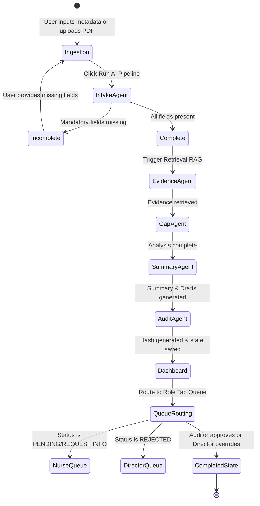

# Data Model Specification: Payer Prior Authorization Evidence Assistant

This document defines the key entities, validation rules, and state transitions for the prototype.

## 1. Central Session State Datastructure

The Central Session State is managed via a typed `SessionState` dataclass passed between agents in the pipeline:

### `SessionState` Structure
- `request_id`: `str` (UUIDv4 format, uniquely identifying the case run)
- `patient_data`: `dict[str, Any]` (parsed demographics, CPT/HCPCS, ICD-10, raw text)
- `classification`: `dict[str, Any]` (service type, urgency status, classification reasoning)
- `evidence`: `list[dict[str, Any]]` (retrieved chunks, source citations, relevance scores)
- `gap_analysis`: `dict[str, Any]` (status, checklist_items, reasoning)
- `artifacts`: `dict[str, str]` (markdown review summary, neutral provider draft communication)
- `audit_trail`: `list[str]` (chronological telemetry logs)
- `review_status`: `str` (current case status: PENDING, APPROVED, REJECTED, REQUEST MORE INFO)
- `routing_queue`: `str` (triage destination: Intake, Nurse Review, Medical Director Review, QA Review)

---

## 2. Entity Specifications

### Entity: `PriorAuthCase`
Represents the incoming prior authorization request.
- **Fields**:
  - `case_id`: `str` (Generated UUID or manual ID)
  - `member_id`: `str` (Extracted from request, e.g. "M123")
  - `provider_id`: `str` (Extracted from request, e.g. "P456")
  - `cpt_code`: `str` (CPT code or procedual name)
  - `icd_code`: `str` (ICD-10 clinical diagnosis code)
  - `service_type`: `str` (Imaging, Surgery, Drug, DME, Behavioral Health, Specialty Referral)
  - `urgency`: `str` (ROUTINE or URGENT)
  - `status`: `str` (Incomplete, Ready for Evidence Review, Under Review, Completed)
  - `attachments`: `list[str]` (Paths or names of uploaded support documents)

### Entity: `PolicyEvidence`
Represents retrieved guideline contexts.
- **Fields**:
  - `source`: `str` (Filename, e.g., "prior-authorization-and-step-therapy-guidelines.pdf")
  - `text`: `str` (Actual excerpt retrieved from policy)
  - `page`: `int` (PDF page number, if extractable, or section name)
  - `score`: `float` (Cosine similarity or matching confidence score)

### Entity: `ChecklistItem`
Structured comparison item for policy guidelines.
- **Fields**:
  - `criterion`: `str` (e.g., "6 weeks conservative therapy")
  - `status`: `str` (Present, Absent, Unclear)
  - `evidence_quote`: `str` (Excerpt from clinical note supporting the status)
  - `source_citation`: `str` (Which file/page supports this status)

### Entity: `AuditLog`
Compliance log block.
- **Fields**:
  - `timestamp`: `str` (ISO-8601 string)
  - `agent`: `str` (Name of executing agent)
  - `action`: `str` (Description of execution step)
  - `payload_hash`: `str` (SHA-256 hash of state variables to prevent tampering)

---

## 3. Case State Machine

