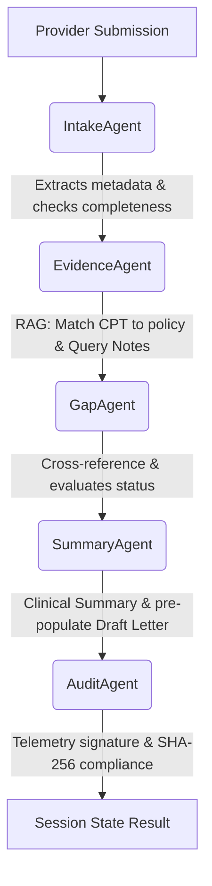

# Implementation Plan: Unified Prior Auth Flow & Mock Policy Ground Truth

**Branch**: `003-unified-prior-auth-flow` | **Date**: 2026-07-09 | **Spec**: [spec.md](file:///c:/Users/gauth/OneDrive/Documents/Study/SpecKit/Test2/specs/003-unified-prior-auth-flow/spec.md)

## Summary

The project is to implement a unified single-pane prior authorization review flow in Streamlit and move the agent ground truth from unstructured PDF guidelines to a structured `data/mock_policies.json` database. The multi-agent pipeline (Intake, RAG, Policy Gap, Summary, and Workflow/Audit Agents) is executed sequentially on user submission and results are rendered contiguously down a single vertical dashboard without tabs.

## Technical Context

**Language/Version**: Python 3.11+

**Primary Dependencies**: `streamlit`, `langchain`, `langchain-openai`, `pypdf`, `faiss-cpu`, `python-dotenv`, `pytest`, `pydantic`

**Storage**: In-memory state and local structured configuration files (`data/mock_policies.json`).

**Testing**: `pytest` for validation and unit/pipeline tests.

**Target Platform**: Streamlit web application.

**Project Type**: Web Application / Multi-agent system.

**Performance Goals**: Complete pipeline execution in under 5 seconds (excluding API call network latency).

## Constitution Check

- **Streamlit UI**: YES (Dashboard is built using Streamlit with a single-pane vertical workflow layout).
- **LangChain multi-agent routing**: YES (Uses LangChain for prompt templating and LLM orchestration).
- **Type hints**: YES (Explicit type hints across all Python modules).
- **Local evidence/in-memory state**: YES (Uses the local structured JSON file at `data/mock_policies.json` and in-memory Streamlit state).

---

## 1. Data Models & Schemas

### Ground-Truth JSON Schema (`data/mock_policies.json`)
The mock policy database defines clinical prerequisites and required document lists mapped to specific CPT codes.
```json
{
  "$schema": "http://json-schema.org/draft-07/schema#",
  "title": "MockPoliciesDatabase",
  "type": "object",
  "properties": {
    "policies": {
      "type": "array",
      "items": {
        "type": "object",
        "properties": {
          "cpt_code": { "type": "string" },
          "service_name": { "type": "string" },
          "specialty_requirement": { "type": "string" },
          "required_documents": {
            "type": "array",
            "items": { "type": "string" }
          },
          "clinical_prerequisites": {
            "type": "array",
            "items": { "type": "string" }
          }
        },
        "required": ["cpt_code", "service_name", "specialty_requirement", "required_documents", "clinical_prerequisites"]
      }
    }
  },
  "required": ["policies"]
}
```

### Pydantic Output Extraction Schemas

#### Intake Parsing Schema (`ProviderSubmission`)
Matches demographics and case request info parsed from incoming notes or API payloads.
```python
from pydantic import BaseModel, Field
from typing import List, Optional

class PatientInfo(BaseModel):
    member_id: Optional[str] = Field(None, description="The member or patient ID (e.g. M123)")
    first_name: Optional[str] = Field(None, description="First name")
    last_name: Optional[str] = Field(None, description="Last name")
    date_of_birth: Optional[str] = Field(None, description="Date of birth in YYYY-MM-DD")

class ProviderInfo(BaseModel):
    provider_id: Optional[str] = Field(None, description="The billing provider ID (e.g. P456)")
    name: Optional[str] = Field(None, description="Provider full name")
    specialty: Optional[str] = Field(None, description="Provider medical specialty")

class ClinicalMetadata(BaseModel):
    cpt_code: Optional[str] = Field(None, description="The CPT/HCPCS procedure code")
    icd_code: Optional[str] = Field(None, description="The ICD-10 diagnosis code")
    requested_service: Optional[str] = Field(None, description="Detailed name of the service requested")
    requested_date: Optional[Optional[str]] = Field(None, description="Requested date")

class DocumentItem(BaseModel):
    document_id: str
    document_type: str
    filename: str
    extracted_text: str

class ProviderSubmission(BaseModel):
    submission_id: str
    patient_info: PatientInfo
    provider_info: ProviderInfo
    clinical_metadata: ClinicalMetadata
    documents: List[DocumentItem]
    is_complete: bool = Field(..., description="True if member_id, provider_id, and cpt_code are present")
    missing_fields: List[str] = Field(default_factory=list, description="Fields missing from: Member ID, Provider ID, CPT Code")
    duplicate_suspected: bool = Field(False, description="True if text indicates duplicate request history")
```

#### Gap Checklist Evaluation Schema (`GapChecklist`)
Translates retrieved policies and evidence matching outcomes into a checklist.
```python
class ChecklistItemModel(BaseModel):
    criterion: str = Field(..., description="The clinical prerequisite rule being checked")
    status: str = Field(..., description="Evaluation status: MUST be PRESENT, ABSENT, or UNCLEAR")
    rationale: str = Field(..., description="Explanation of why this rule status was assigned")
    citation: Optional[str] = Field(None, description="Source quote or document reference matching the evidence")

class GapExtraction(BaseModel):
    status: str = Field(..., description="Overall compliance status: APPROVED, PENDING, or REJECTED")
    reasoning: str = Field(..., description="Summary reasoning for the gap decision")
    checklist_items: List[ChecklistItemModel] = Field(default_factory=list)
    missing_info: List[str] = Field(default_factory=list, description="Documents or facts missing from the case notes")
```

---

## 2. Backend & Agent Orchestration (LangChain)

### LangChain Orchestration
- **LLM Selection**: Use `gpt-4o-mini` with temperature 0 for extraction and auditing, and `gpt-4o-mini` for clinical summarization.
- **Document Loading**: Use custom string parsers for plain text and `PyPDFLoader` to read uploaded PDF pages.
- **Structured Extraction**: Bound to models using the `.with_structured_output(Schema)` functionality.



### Retrieval Strategy (RAG Agent)
1. **Policy Lookup**: Queries `data/mock_policies.json` directly using the case CPT code.
2. **Clinical Notes Indexing**: Splits clinical document text into chunks and creates an in-memory vector store using `FAISS` and `OpenAIEmbeddings`.
3. **Prerequisite Querying**: For each prerequisite rule retrieved from the Mock Policy JSON, the RAG Agent queries the FAISS index for relevant evidence passages, selecting matches with high cosine similarity scores. The results are loaded as citations.

### Sequential Handoff
1. **Intake Agent**: Extracts patient/provider details and CPT code, determines service type, flags missing core fields.
2. **Evidence Agent**: Resolves CPT policy guidelines and finds matches within patient notes.
3. **Gap Agent**: Takes retrieved evidence and evaluates compliance against prerequisites. Employs a strict isolated prompt structure executing Chain-of-Thought reasoning for each prerequisite independently, returning structured outputs with explicit evaluations: `PRESENT` (explicitly stated), `ABSENT` (neither mentioned nor implied), and `UNCLEAR` (lacks duration or specifics).
4. **Summary Agent**: Writes the clinical summary and drafts the provider letter requesting any missing prerequisites.
5. **Audit/Workflow Agent**: Confirms review state transitions, records audit logs, and creates the cryptographic signature hash.

---

## 3. Frontend Architecture (Streamlit)

### Stepper Component Layout
The Streamlit layout uses a persistent sidebar and conditional stepper stage rendering:
1. **Persistent Context Sidebar (`st.sidebar`)**:
   - Patient Demographics (Member ID, Provider ID, CPT, ICD-10, Specialty/Service Type).
   - Case details (Request ID, Queue Route, Triage Status).
   - Expander showing the complete extracted text of the uploaded clinical notes for reference during the entire review process.
2. **Main Stage Stepper (Step-by-Step rendering)**:
   - **Step 1 (Ingestion & Upload)**: Displays the file uploader and manual metadata entry forms. Triggering "Run AI Pipeline" runs the Intake and Evidence agents, transitions `current_step = 2`, and reruns.
   - **Step 2 (RAG Verification & Gap Analysis)**: Split 50/50 side-by-side columns (Left: extracted patient demographics, Right: retrieved guidelines from `data/mock_policies.json`) followed by the colored checklist criteria. Clicking "Generate Summary & Route" runs the Gap & Summary agents, transitions `current_step = 3`, and reruns.
   - **Step 3 (Actionable Decision Dashboard)**: Exposes case summary, editable provider correspondence draft, horizontal routing triage buttons, and Audit Telemetry expander. Includes a "Back to Evidence" button setting `current_step = 2`.

### Streamlit Session State Management
To prevent step transitions and input events from clearing data, the following session keys are persisted:
- `st.session_state["active_state"]`: Caches the current `SessionState` datastructure.
- `st.session_state["cases"]`: Stores active cases.
- `st.session_state["draft_communication"]`: Caches the editable draft letter.
- `st.session_state["current_step"]`: Controls the active stepper stage (initialized to 1).

---

## 4. Error Handling & Fallbacks

### Failure Scenarios

- **Mock JSON Missing/Corrupted**: Loads a local dictionary fallback in `evidence_agent.py` to prevent crashes:
  ```python
  FALLBACK_POLICIES = {
      "72148": {"service_name": "Lumbar Spine MRI", ...},
      "96372": {"service_name": "Adalimumab Specialty Drug", ...},
      "27447": {"service_name": "Total Knee Arthroplasty", ...}
  }
  ```
- **Unrecognized CPT Code**: The RAG agent flags the case as "Unmapped Policy Guidelines," sets the status to `PENDING`, and bypasses automated checks, displaying a prominent warning banner requesting manual human review.
- **Contradictory Clinical Text**: The Gap Agent assigns an `UNCLEAR` status to the affected criteria, highlights the contradiction in the checklist rationale, and appends an warning to the summary brief.
